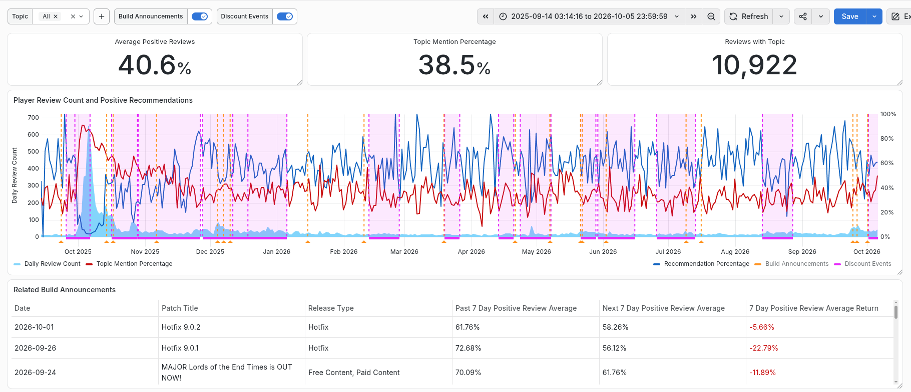
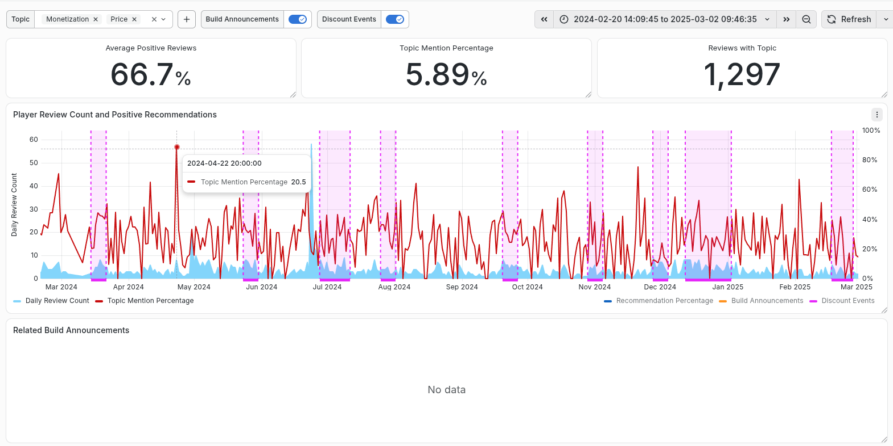
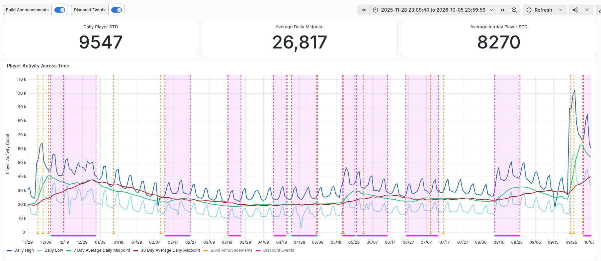
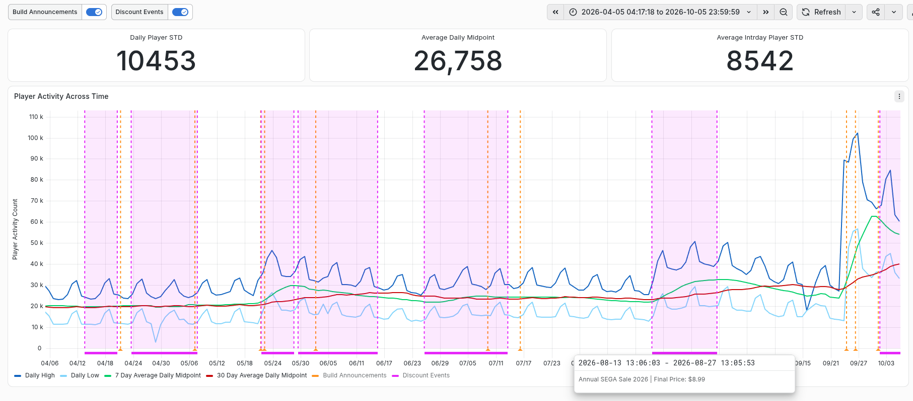

# Player Review and Activity Analysis for Warhammer 3 with Grafana

This project was born out of the previous Power BI analysis of player sentiment, and activity in Total Warhammer 3. Instead of Power BI, I wanted to shift things towards Grafana that also included setting up a local data base, and using SQL for queries in Grafana.

By using Grafana discount events were made more visible with start, and end dates more intuitively than with Power Bi. This added another layer of events to see their impact on players, and the data included a final price of the discount for comparison.

## Project Questions
Similar questions are asked that were present in the previous project except with better integration of discount events markers in Grafana.

- What patterns appear in player activity and reviews over time?
- How does player sentiment and engagement change around developer build releases?
- How does player sentiment differ across common review topics?
- How much is player engagement affected by different types of build announcements?
- What impact do discount events have on player activity over a period of time?
- Does the final amount of the discount affect player activity?
- Do the discount events affect player sentiment topics, such as for price or monetization?
- What effect does having discounts events, and build announcements occuring in conjunction have on players?

## Tools

- Docker
- PostgreSQL
- Python
- SQL

## Data

- Steam player reviews from 2024 through 2026: (https://store.steampowered.com/appreviews/1142710)
- Historical player activity data from games-popularity: (https://games-popularity.com)
- Developer announcements, discount events and release information from SteamDB: (https://steamdb.info/app/1142710/patchnotes/)
- LLM assisted text filtering for player reviews, build announcements, and discount events
- Manual cleanup of player reviews, build announcements, and discount events

## Workflow

- Collected Steam review and player activity data through api with a Python script
- Used an LLM assisted process to identify common topics across +50,000 review texts
- Kept and organized recurring topics into their own columns
- Performed some manual clean up in LibreOffice Calc
- Established a local database with Docker and PostgreSQL
- Connected the local relational database to Grafana
- Used SQL to perform queries for interactive visuals in Grafana

### Player Review

The Player Review dashboard retained its core functionalty present in the previous project that looked beyond the overall Steam rating and examined what players were actually discussing. With the better visual integration of discount events these could be better analyzed for affect on activity in additiona to build announcements.

- Filter reviews by topic and date
- Compare review volume with positive recommendation percentage
- View developer build announcements alongside review activity
- Compare sentiment before and after selected updates
- Provide annotations for discount events and their final price

One example is constraining the topic's affect on player sentiment for the game's cost, such as for Monetization (reviews about strategies for payment or commercial practices) and Price (reviews about the actual affordability of the game). In the brief time span example there is only a small correlation, and generally the higher peaks for these topics are not within a discount event. This could suggest the impact of discounts on reviews involving cost is minor, and could be examined further for the discount's final cost. 

Lastly, the "Related Build Announcements" correctly shows that there aren't any builds that involve the selected topics.

### Player Activity

player engagement has most of the features from the previous project in addition to annotations for Discount Events alongside Build Announcements.

- Daily player activity
- Daily highs and lows
- 7 day averages
- 30 day averages
- Interactive annotations for Build Announcement and Discount Event

## Key Findings

Many of the findings were similar to the previous Power BI project.

- Player activity follows a clear weekly cycle with stronger activity around weekends
  - Is there an opportunity here to improve engagement for the weekdays?
- Higher review volume does not always correspond with more positive sentiment
  - Does this reveal an issue in the QA process that results in negative player feedback?
  - How much does negative player feedback affect sales?
- Breaking reviews into specific topics provides more useful context than looking only at the overall review score
  - Are there any other topics or annoucements we can breakdown for analytics?
- Player Activity spiked around major discount events and major content releases
  - Is there way to strategically align your discounts to grow the player base?
  - Will that player base purchase subsequent content?

## Limitations

Similar limitations apply as from the previous project.

- Limited time span of data between 2024 to 2026 due to reliable historical data missing before 2024
- The analysis is observational and does not prove that releases caused changes in sentiment or player activity
- While promotional/seasonal discount events are included, there may still be other marketing campaigns, weekends, and unrelated events also influenced the results
- Dropping the category of "Other" helped to reduce data on topics from being consisted wit LLM assisted topic classification, but it can still introduce inconsistent categorization of the data
- Steam reviewers may not represent the full player population
- Short analysis windows can overlap with other build announcements or events

## Reproduction

- Configure your .env following the .env.example
- Recommended to install a virtual environment to install project dependcies or install them normally
  - requirements.txt contains a list of dependencies for scripts
- Run DataPull.py if you want to regenerate the data sets for Activity and Reviews 
  - Fresh pulls will need an LLM for topic categorization of text, and manual cleanup
- Download .csv for Price History from SteamDB if you don't want to use provided data set (a log in may be required)
  - Fresh .csv would need to be manually edited, or LLM assisted for your work flow to match the reference .csv provided
- Extract Builds from Patches on steamdb by selecting the whole table+values, copying, and pasting it to be converted into a table with a spreadsheet program (LibreOffice Calc works)
  - Manually edit to rename or remove unnecessary columns/rows to match the reference .csv provided (such as excluding "No title" builds)
- After data is acquired and put into the correct directory follow the exact names provided by the reference .csv for DataIngest.py when the database is ready
- In the same directory of the project compose up with "docker compose up -d" in a terminal
- Run something like VSCode or similar for PostgreSQL/Python/SQLTools
- Start PostgreSQL and Grafana with Docker Compose
- Run wh3_analysis.sql once to create the database, role, tables, indexes, and permissions (running it again may overwrite data)
- Make a connection to the PostgreSQL Project Database for extensions like PostgreSQL in VSCode
- Configure Grafana's PostgreSQL data source to your local database
  - Grafana may need a first time admin setup
  - Remeber to use the passwords in your own .env such as GRAFANA_READER_PASSWORD
- Import the two dashboard JSON files containing the visualization information